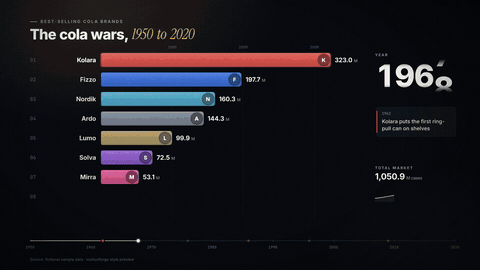
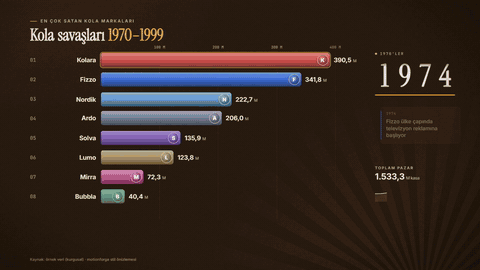
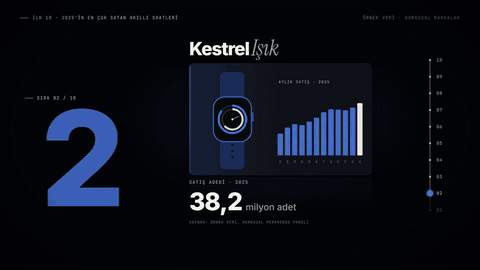
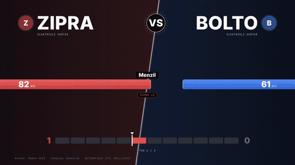
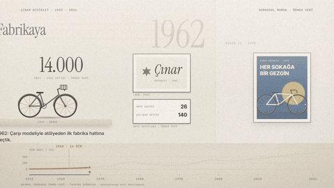
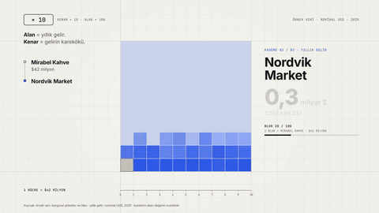
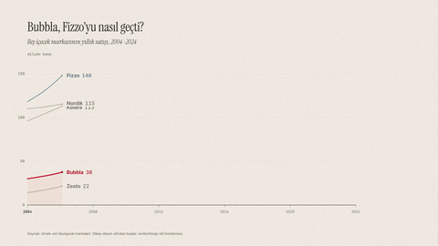
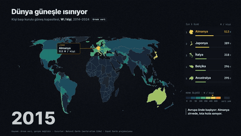

# Style catalogue

108 styles in 21 categories. Every style is a `STYLE.md` in the same format (`_template/STYLE.md`) with an animated preview rendered by the HyperFrames engine from [`examples/styles/`](../../../examples/styles/).
How to pick, customise or create one: [`../SKILL.md`](../SKILL.md). All styles are original motionforge work (MIT); fonts named in them are free (SIL OFL or similar) and are installed from Fontsource, not bundled. Previews use fictional names, places and sample data.

**Categories:** [Creators & personal brands](#creators--personal-brands) · [E-commerce & products](#e-commerce--products) · [Real estate & maps](#real-estate--maps) · [Football & sports](#football--sports) · [Documentary & storytelling](#documentary--storytelling) · [Education & explainers](#education--explainers) · [Tech, SaaS & AI](#tech-saas--ai) · [Finance & money](#finance--money) · [Food & restaurants](#food--restaurants) · [Fitness, health & wellness](#fitness-health--wellness) · [Travel & hospitality](#travel--hospitality) · [Music, events & weddings](#music-events--weddings) · [News & commentary](#news--commentary) · [Business, B2B & local](#business-b2b--local) · [Gaming & esports](#gaming--esports) · [Kids & animation](#kids--animation) · [Fashion & beauty](#fashion--beauty) · [Automotive](#automotive) · [Art direction & design looks](#art-direction--design-looks) · [Nonprofit & causes](#nonprofit--causes) · [Data rankings & races](#data-rankings--races)

## Creators & personal brands

<table>
  <tr><td align="center" valign="top" width="25%"> <code>creator-reels-dark</code> Charcoal + lime accent, bold sans with an italic-serif word, pop-out talking head in a rounded card</td><td align="center" valign="top" width="25%"> <code>kinetic-captions</code> Big voice-synced words on a quiet field, accent on the stressed word</td><td align="center" valign="top" width="25%"> <code>vlog-film-diary</code> Warm faded day footage, orange LED date stamp, pen notes, moments that freeze into prints</td><td align="center" valign="top" width="25%"> <code>podcast-clip-studio</code> Speaker windows with a coral ring on the voice, waveform playhead, italic pull-quote</td></tr>
  <tr><td align="center" valign="top" width="25%"> <code>talking-head-pop</code> Punch-in on every cut, white caption plates with a yellow key word, giant word behind the head</td><td align="center" valign="top" width="25%"> <code>minimal-journal</code> A beige page, thin serif lines one at a time, small mounted photos, long dissolves</td><td align="center" valign="top" width="25%"> <code>cinematic-quote</code> Footage in a widescreen band, a large serif quote line by line, warm light leaks</td><td width="25%"></td></tr>
</table>

| Style | Look | Best for | Engine |
|---|---|---|---|
| [creator-reels-dark](creator-reels-dark/STYLE.md) | Charcoal stage, one lime accent, a bold sans headline with a single italic-serif word, and the presenter's head breaking out… | talking-head explainers about tools, AI, software, creator tips | remotion (edit) + hyperframes (scenes) |
| [kinetic-captions](kinetic-captions/STYLE.md) | The words are the picture: big, voice-synced type that lands word by word on a quiet field, with one accent colour marking the… | voice-led shorts without footage, quotes, hot takes, story hooks | hyperframes (or canvas) |
| [vlog-film-diary](vlog-film-diary/STYLE.md) | A day told in warm, slightly faded footage: an orange LED date stamp in the corner, handwritten time-of-day notes, and moments… | daily vlogs, travel days, "a day in my life", weekly recaps | remotion (edit) + hyperframes (overlays) |
| [podcast-clip-studio](podcast-clip-studio/STYLE.md) | A vertical cut of a long conversation: the speaker in a framed window, a coral ring on whoever is talking, a waveform bar with… | podcast and interview clips, panel highlights, live-stream cut-downs | remotion (edit) + hyperframes (graphics) |
| [talking-head-pop](talking-head-pop/STYLE.md) | Full-frame phone footage of one person talking, a punch-in on every cut, chunky captions on white plates with the key word on… | opinion and advice shorts, coaching tips, story-time, reactions | remotion (edit) + hyperframes (cards) |
| [minimal-journal](minimal-journal/STYLE.md) | A beige page, thin serif lines appearing one at a time, small mounted photographs and long dissolves — like reading someone's… | calm personal stories, reflections, letters, year-in-review, slow essays | hyperframes |
| [cinematic-quote](cinematic-quote/STYLE.md) | Footage inside a widescreen band between black bars, a slow push, a large serif quote set in the lower bar line by line, and a… | quotes, mottos, short reflections, book lines, motivational openers | hyperframes (remotion for long footage) |

## E-commerce & products

<table>
  <tr><td align="center" valign="top" width="25%"> <code>product-hero-turntable</code> One product turning on a white plinth, leader lines snap to features with teal dots</td><td align="center" valign="top" width="25%"> <code>unboxing-pop</code> Top-down on kraft, flaps fold open, items rise with a squash, pink stickers slap on</td><td align="center" valign="top" width="25%"> <code>flash-sale</code> Sale red, yellow starbursts, screen-high numbers, the old price slashed on the beat</td><td align="center" valign="top" width="25%"> <code>ugc-testimonial</code> Customer clips as review cards: name, city, real stars, the key phrase swept with a marker</td></tr>
  <tr><td align="center" valign="top" width="25%"> <code>catalog-grid</code> A wall of white product tiles, the camera dives into one, a red-orange tag swings in</td><td align="center" valign="top" width="25%"> <code>before-after-split</code> One frame, one slider: grey before, mint after, a round handle scrubbing between</td><td align="center" valign="top" width="25%"> <code>luxury-product</code> A product rising from black into warm light, a gold sweep, Bodoni name over a hairline</td><td align="center" valign="top" width="25%"> <code>beauty-glow</code> Blush field, glossy highlight on the bottle, a droplet ripple, ingredients on rosewood leaders</td></tr>
</table>

| Style | Look | Best for | Engine |
|---|---|---|---|
| [product-hero-turntable](product-hero-turntable/STYLE.md) | One product turning slowly on a white plinth in a cool-grey studio cove, soft contact shadow, thin leader lines snapping to… | product launches, feature tours, spec explainers, store listings | hyperframes + three.js |
| [unboxing-pop](unboxing-pop/STYLE.md) | Top-down on kraft cardboard: flaps fold open one after another, items rise out with a squash, and die-cut pink stickers slap… | unboxings, subscription boxes, order reveals, "what's in the kit" | hyperframes (+ three.js for the box) |
| [flash-sale](flash-sale/STYLE.md) | Saturated red field, yellow starburst cards, condensed numbers the height of the screen, an old price slashed on the beat and… | time-limited sales, discount codes, seasonal promos, launch-day offers | hyperframes |
| [ugc-testimonial](ugc-testimonial/STYLE.md) | Real customers' phone clips framed as rounded review cards: their first name and city, the stars they actually gave, and the… | customer reviews, social proof ads, service testimonials, app reviews | remotion (edit) + hyperframes (cards) |
| [catalog-grid](catalog-grid/STYLE.md) | A gallery wall of white product tiles on a warm-grey field; the camera glides across it, dives into one tile until it fills… | collection launches, shop tours, "5 picks under X", new arrivals, gift guides | hyperframes |
| [before-after-split](before-after-split/STYLE.md) | One frame divided by a slider: "before" on the left under a grey tag, "after" on the right under a mint tag, a round handle… | renovations, cleaning, detailing, design makeovers, photo edits, product results | hyperframes (remotion for timelapse footage) |
| [luxury-product](luxury-product/STYLE.md) | A product rising out of black into a warm pool of light, a narrow gold light sweep gliding across its surface, a high-contrast… | jewellery, watches, fragrance, leather goods, fine spirits, premium launches | hyperframes + three.js (remotion for macro footage) |
| [beauty-glow](beauty-glow/STYLE.md) | A soft blush field, a glossy specular highlight gliding across bottles and skin close-ups, falling droplets that ripple, and… | skincare and cosmetics, routines, ingredient explainers, salon services | hyperframes (remotion for routine footage) |

## Real estate & maps

<table>
  <tr><td align="center" valign="top" width="25%"> <code>map-flyover-pins</code> Dark muted map tilts and glides, a coral route draws itself, pins drop with distance chips</td><td align="center" valign="top" width="25%"> <code>floorplan-draw-on</code> Walls trace and fill graphite on vellum, doors swing, rooms take ochre with name and area</td><td align="center" valign="top" width="25%"> <code>listing-tour-cards</code> Bright walkthrough footage, white fact cards with a teal tab rise for price, rooms and area</td><td align="center" valign="top" width="25%"> <code>neighborhood-guide</code> Daylight map around one home, walking-time rings breathe out, amenity badges pop by category</td></tr>
  <tr><td align="center" valign="top" width="25%"> <code>luxury-estate</code> Slow moves through a fine home, spaced-capital serif titles, a champagne hairline frame</td><td align="center" valign="top" width="25%"> <code>market-stats</code> Cool research paper, districts as sorted bars, one raspberry district with a trend arrow</td><td width="25%"></td><td width="25%"></td></tr>
</table>

| Style | Look | Best for | Engine |
|---|---|---|---|
| [map-flyover-pins](map-flyover-pins/STYLE.md) | A dark, desaturated street map tilts and glides between places: a coral route line draws itself, pins drop with a bounce and… | property location, "how far is it from…", commutes, branch openings, short itineraries | hyperframes (SVG or vector-tile map); hyperframes + three.js for the 3D arrival |
| [floorplan-draw-on](floorplan-draw-on/STYLE.md) | An architect's presentation plan on warm drafting vellum: walls trace and fill solid graphite, door swings arc open, and rooms… | layouts of flats and houses, off-plan sales, renovation before/after, furniture fit | hyperframes (layered SVG); hyperframes + three.js for plan-to-volume |
| [listing-tour-cards](listing-tour-cards/STYLE.md) | Bright daylight walkthrough footage with slow pans, and crisp white fact cards with a teal edge tab that slide up for price,… | sale and rental listings, agent reels, open-house invites | hyperframes (cards) + remotion (optional, footage-heavy edits) |
| [neighborhood-guide](neighborhood-guide/STYLE.md) | A friendly daylight street map centred on one home: walking-time rings breathe outward and amenity badges pop in category by… | area guides, relocation, "what's within 10 minutes", local business area promos | hyperframes (SVG map); hyperframes + three.js for the tilted intro |
| [luxury-estate](luxury-estate/STYLE.md) | Slow drone and gimbal moves through a high-end home, thin spaced-capital serif titles, a champagne hairline frame and long… | premium listings, architect-designed homes, villas and hotels for sale, developer launch films | remotion (footage edit) + hyperframes (titles) |
| [market-stats](market-stats/STYLE.md) | A crisp property research note on cool paper: price-per-m² columns rise, districts line up as sorted bars, and one raspberry… | housing market updates, rent vs buy, district comparisons, agency market reports | hyperframes (SVG charts); hyperframes + three.js for one hero chart |

## Football & sports

<table>
  <tr><td align="center" valign="top" width="25%"> <code>matchday-graphics</code> Night-match package: navy floodlight haze, slanted score panels in kit colours, amber clock</td><td align="center" valign="top" width="25%"> <code>tactics-board</code> Tilted matte pitch, flat tokens shift shape, passes draw, cyan pressing zones bloom</td><td align="center" valign="top" width="25%"> <code>player-stat-card</code> Collectible card, silver foil sweep, a mint radar that unfolds, ratings that count up</td><td align="center" valign="top" width="25%"> <code>transfer-breaking</code> Red breaking bar, diagonal club split, a fee odometer and a five-step confirmation meter</td></tr>
  <tr><td align="center" valign="top" width="25%"> <code>telestrator-replay</code> The play freezes, one player in a spotlight, yellow pen strokes pinned to the pitch</td><td align="center" valign="top" width="25%"> <code>fixture-countdown</code> Matchday paper, split-flap tiles to the next opponent, a green days-to-go countdown</td><td align="center" valign="top" width="25%"> <code>athlete-hype-reel</code> Freeze on the decisive frame, duotone, a huge name behind the athlete, blue stat chips</td><td width="25%"></td></tr>
</table>

| Style | Look | Best for | Engine |
|---|---|---|---|
| [matchday-graphics](matchday-graphics/STYLE.md) | A night-match broadcast package: navy field under floodlight haze, slanted score panels in the two kit colours, lineups that… | match previews, lineups, live-score and full-time posts for clubs, fan and sports-media accounts | hyperframes (graphics) + remotion (optional, footage-heavy edits) |
| [tactics-board](tactics-board/STYLE.md) | A tilted matte-green pitch where flat player tokens shift into shape, pass arrows draw ball by ball, and cyan pressing zones… | tactical analysis, coaching sessions, formation explainers, "how this goal was built" | hyperframes (SVG board) or hyperframes + three.js (tilted pitch) |
| [player-stat-card](player-stat-card/STYLE.md) | A tall collectible card with a cut-out player breaking its top edge, a silver foil border that catches one moving light, a… | player profiles, scouting summaries, season reviews, head-to-heads, academy player cards | hyperframes + three.js (card tilt) or hyperframes (flat) |
| [transfer-breaking](transfer-breaking/STYLE.md) | A hard red breaking bar tears across the frame, the screen splits diagonally into two club-colour fields, a fee odometer rolls… | transfer news, contract renewals, signing announcements, rumour round-ups for sports media and fan accounts | hyperframes |
| [telestrator-replay](telestrator-replay/STYLE.md) | Real match footage slows and freezes, everything dims except one player, and bright yellow pen strokes are drawn over the play… | analysis on real footage, refereeing decisions, coaching feedback on amateur and academy video | hyperframes (overlays) + remotion (optional, footage-heavy edits) |
| [fixture-countdown](fixture-countdown/STYLE.md) | A printed matchday-programme feel on warm paper: split-flap tiles clatter to the next opponent and date, a giant days-to-go… | next-match posts, season and month schedules, tournament group stages, ticket reminders, local league updates | hyperframes |
| [athlete-hype-reel](athlete-hype-reel/STYLE.md) | Fast highlights of one athlete: on the decisive frame the action freezes, the frame turns to a crushed-black duotone, the… | individual highlight reels, recruiting and scouting tapes, signing posts, season recaps, any sport | remotion (footage cut) + hyperframes (slams and chips) |

## Documentary & storytelling

<table>
  <tr><td align="center" valign="top" width="25%"> <code>archival-newsreel</code> Black-and-white film, gate weave and dust, slab-serif title cards</td><td align="center" valign="top" width="25%"> <code>true-crime-board</code> Dim corkboard, pinned cards, red string between them, redaction bars that lift</td><td align="center" valign="top" width="25%"> <code>nature-field-notes</code> A notebook ink sketch draws itself and fades to the real scene, specimen tags and scale bars</td><td align="center" valign="top" width="25%"> <code>history-map-campaign</code> Engraved paper map, a madder arrow sweeps the route while the dated caption ticks</td></tr>
  <tr><td align="center" valign="top" width="25%"> <code>interview-doc</code> Off-centre interview, amber-rule name supers, serif chapter cards on black</td><td align="center" valign="top" width="25%"> <code>timeline-chronicle</code> Gallery-green wall, years roll like an odometer, photo cards drop onto their wires</td><td align="center" valign="top" width="25%"> <code>cosmos-scale</code> Black space at true proportions, the camera pulls back a decade at a time, amber counters</td><td width="25%"></td></tr>
</table>

| Style | Look | Best for | Engine |
|---|---|---|---|
| [archival-newsreel](archival-newsreel/STYLE.md) | Black-and-white film stock, gate weave and dust, bold slab-serif title cards, and an announcer's cadence — history told like a… | "how it started", anniversaries, history of a technology or company | canvas (film effects) + hyperframes (title cards) |
| [true-crime-board](true-crime-board/STYLE.md) | A dim corkboard under one desk lamp: case photos pinned at slight angles, red string pulled between them, typewritten dates,… | case recaps, fraud and scam stories, historical mysteries, court-case explainers | hyperframes |
| [nature-field-notes](nature-field-notes/STYLE.md) | A naturalist's notebook: an ink sketch of the animal draws itself and real footage fades in beneath until they match, with… | wildlife and plant profiles, ecology, trails and parks, citizen science | canvas (sketch strokes) + hyperframes (plates, labels) |
| [history-map-campaign](history-map-campaign/STYLE.md) | An engraved map on aged paper where two inks advance and retreat: tapered arrows sweep along routes, borders redraw, and a… | campaigns and battles, empires, migrations, border changes, trade routes | hyperframes (SVG map) + three.js for globe openers |
| [interview-doc](interview-doc/STYLE.md) | Quiet documentary interview: a person framed off-centre, name supers that slide out from behind a thin amber rule, slow pushes… | founder stories, oral histories, expert interviews, customer stories, mini-docs | remotion (footage edit) + hyperframes (supers, chapter cards) |
| [timeline-chronicle](timeline-chronicle/STYLE.md) | A museum wall painted deep green: one horizontal line runs through the frame, big serif years roll past like an odometer, and… | company and product histories, biographies, "how X changed", anniversaries | hyperframes |
| [cosmos-scale](cosmos-scale/STYLE.md) | Black space with honest proportions: planets and stars at true relative size, a camera that pulls back one order of magnitude… | astronomy, space missions, "how big is…", distance and light-time explainers | hyperframes + three.js (canvas starfield) |

## Education & explainers

<table>
  <tr><td align="center" valign="top" width="25%"> <code>math-explainer</code> Colour-coded geometry and equations morphing on dark slate</td><td align="center" valign="top" width="25%"> <code>marker-whiteboard</code> Marker sketches drawn live on a clean board, arrows and circles</td><td align="center" valign="top" width="25%"> <code>blueprint-schematic</code> White line work on cyanotype blue, exploded views, callouts (no grid)</td><td align="center" valign="top" width="25%"> <code>storybook-isometric</code> Pastel isometric miniatures that assemble block by block</td></tr>
  <tr><td align="center" valign="top" width="25%"> <code>science-lab</code> Bright lab bench, labelled glassware, an indicator flips colour as a 3D molecule swaps bonds</td><td align="center" valign="top" width="25%"> <code>language-flashcards</code> Cream cards on teal, the word flips to meaning and IPA, the stressed syllable jumps</td><td align="center" valign="top" width="25%"> <code>quiz-countdown</code> Game-show cobalt, four white tiles, a yellow 3-2-1 ring, the right tile turns green</td><td align="center" valign="top" width="25%"> <code>chalkboard-lesson</code> Green board in a wooden frame, chalk writes itself, yellow circles the answer, eraser wipes</td></tr>
</table>

| Style | Look | Best for | Engine |
|---|---|---|---|
| [math-explainer](math-explainer/STYLE.md) | Clean geometry and equations on a dark slate: shapes transform into each other, terms of an equation move to where they… | maths, physics, algorithms, ML concepts, any "why does this work" | canvas (or hyperframes with SVG + KaTeX) |
| [marker-whiteboard](marker-whiteboard/STYLE.md) | Hand-drawn marker sketches appearing on a clean board: simple icons, arrows and boxed words that build an idea step by step,… | concepts, frameworks, processes, education | hyperframes (SVG stroke draw) or canvas |
| [blueprint-schematic](blueprint-schematic/STYLE.md) | White technical line work on deep cyanotype blue: parts drawn stroke by stroke, dimension lines, callouts and exploded views —… | how-it-works, engineering, architecture, product anatomy | hyperframes (SVG stroke drawing) or canvas |
| [storybook-isometric](storybook-isometric/STYLE.md) | Small, tidy isometric worlds in soft pastel paint — tiny houses, roads and machines that assemble themselves while a calm… | systems, processes, cities, supply chains, "how the internet works" | canvas or hyperframes (CSS 3D / three.js orthographic) |
| [science-lab](science-lab/STYLE.md) | A bright lab bench: clean labelled glassware, ball-and-stick molecules turning in 3D beside it, a reagent that changes colour… | chemistry, biology and physics demos, "what happens when…", school and university science | hyperframes + three.js |
| [language-flashcards](language-flashcards/STYLE.md) | Cream cards on a deep teal desk: a word flips to show its meaning and IPA, the stressed syllable jumps on its beat, and an… | vocabulary, pronunciation drills, phrase packs, false friends, short grammar points | hyperframes |
| [quiz-countdown](quiz-countdown/STYLE.md) | Game-show cobalt: a big question, four white answer tiles, a yellow 3-2-1 ring that drains exactly on the second, and a reveal… | trivia, test-yourself series, exam and licence-test practice, recap quizzes | hyperframes |
| [chalkboard-lesson](chalkboard-lesson/STYLE.md) | A worn green classroom board in a wooden frame: chalk handwriting writes itself with a little dust, yellow chalk underlines… | school lessons, grammar rules, worked examples, mnemonics, teacher accounts | canvas |

## Tech, SaaS & AI

<table>
  <tr><td align="center" valign="top" width="25%"> <code>screencast-zoom</code> Real screens in a floating window, guided zooms and highlights</td><td align="center" valign="top" width="25%"> <code>terminal-crt</code> Phosphor monospace on a tube, typing commands, scanlines and bloom</td><td align="center" valign="top" width="25%"> <code>keynote-dark</code> Near-black stage, one lit hero object, gradient word, big numbers</td><td align="center" valign="top" width="25%"> <code>saas-launch-glass</code> Frosted glass over a blurred product, a lens sharpens the feature, rose chips mark what is new</td></tr>
  <tr><td align="center" valign="top" width="25%"> <code>ai-agent-flow</code> Ink diagram on sage paper, agents and tools as nodes, violet pulses along the edges</td><td align="center" valign="top" width="25%"> <code>code-diff</code> Dark editor, removed lines strike and fold, added lines type in green, yellow review pins</td><td width="25%"></td><td width="25%"></td></tr>
</table>

| Style | Look | Best for | Engine |
|---|---|---|---|
| [screencast-zoom](screencast-zoom/STYLE.md) | Real screens, framed and directed: a browser or app window floats on a soft backdrop, the camera glides and zooms to each… | product demos, tutorials, repo/site walkthroughs, "how I did X" | hyperframes (or remotion) |
| [terminal-crt](terminal-crt/STYLE.md) | A glowing phosphor terminal on a curved tube: monospaced text typing out, a blinking block cursor, scanlines and a faint bloom… | developer tools, AI agents, hacking/security explainers, CLI walkthroughs | hyperframes (or canvas for the tube effect) |
| [keynote-dark](keynote-dark/STYLE.md) | A product-launch stage: near-black space, one luminous object, a gradient-lit headline word and big confident numbers revealed… | launches, feature reveals, before/after numbers, annual recaps | hyperframes (CSS 3D / three.js) |
| [saas-launch-glass](saas-launch-glass/STYLE.md) | Frosted glass panes float over a blurred capture of the real product; feature chips snap onto the glass one per beat, and a… | SaaS launches, feature drops, changelog videos, pricing updates | hyperframes + three.js (device shots) |
| [ai-agent-flow](ai-agent-flow/STYLE.md) | A clean ink diagram on pale sage paper: agents as rounded nodes, tools as square chips, and violet pulses travelling along the… | agent architectures, automations, tool-calling explainers, workflow builds | hyperframes (SVG) or canvas |
| [code-diff](code-diff/STYLE.md) | A dark code editor where removed lines tint red and collapse, added lines open and type in green, and highlighter-yellow… | code reviews, refactors, bug-fix stories, "what changed in this PR", AI-written code | hyperframes |

## Finance & money

<table>
  <tr><td align="center" valign="top" width="25%"> <code>data-story</code> Honest charts, grey first, one accent insight, visible source</td><td align="center" valign="top" width="25%"> <code>market-terminal</code> Sober trading screen, ticker tape, candles build bar by bar, an amber crosshair on the move</td><td align="center" valign="top" width="25%"> <code>crypto-neon-chart</code> One glowing aqua price line on black, glossy coin cards that flip, transfers traced as pulses</td><td align="center" valign="top" width="25%"> <code>budget-infographic</code> Pastel icons on warm cream, a donut that splits into categories, a green savings counter</td></tr>
  <tr><td align="center" valign="top" width="25%"> <code>receipt-roll</code> A thermal receipt prints line by line, the total pauses, a blue rubber stamp lands</td><td width="25%"></td><td width="25%"></td><td width="25%"></td></tr>
</table>

| Style | Look | Best for | Engine |
|---|---|---|---|
| [data-story](data-story/STYLE.md) | Clean, honest charts that animate one insight at a time: bars grow, lines draw, the key point lights up in the accent and gets… | statistics, trends, comparisons, research summaries | hyperframes (SVG/HTML charts) |
| [market-terminal](market-terminal/STYLE.md) | A dense, sober trading-desk screen: monospaced prices, a scrolling ticker tape, candlesticks that build bar by bar, cells that… | market recaps, earnings, macro news, stock and index explainers | hyperframes + three.js (globe scene only) |
| [crypto-neon-chart](crypto-neon-chart/STYLE.md) | One glowing aqua price line racing across a black field, glossy coin and wallet cards that flip into view, and transfers… | crypto and token explainers, on-chain stories, wallet how-tos, volatility recaps | hyperframes + three.js (coin and wallet renders) |
| [budget-infographic](budget-infographic/STYLE.md) | Friendly pastel icons on warm cream, a donut that splits into spending categories, bars that compare months, and a green… | personal budgeting, saving plans, cost-of-living breakdowns, money tips | hyperframes (SVG) |
| [receipt-roll](receipt-roll/STYLE.md) | A thermal printer feeds a receipt line by line in step with the voice; prices align right, a dashed rule prints, the total… | price breakdowns, "what I spent", cost comparisons, hidden fees, shopping hauls | hyperframes (canvas for paper curl) |

## Food & restaurants

<table>
  <tr><td align="center" valign="top" width="25%"> <code>bistro-menu-cards</code> Cream menu cards on linen, the dish slides out from under, a bottle-green special stamp</td><td align="center" valign="top" width="25%"> <code>recipe-top-down</code> Overhead worktop, numbered step cards slide up, a tomato timer ring runs on fast-forward</td><td align="center" valign="top" width="25%"> <code>food-macro-warm</code> Warm close-ups, shallow focus and steam, a big italic appetite word tucked behind the food</td><td width="25%"></td></tr>
</table>

| Style | Look | Best for | Engine |
|---|---|---|---|
| [bistro-menu-cards](bistro-menu-cards/STYLE.md) | Cream menu cards placed one by one on real linen; dish photos slide out from under the paper, prices sit in a refined serif,… | restaurant and café menus, daily specials, tasting menus, opening announcements | hyperframes |
| [recipe-top-down](recipe-top-down/STYLE.md) | A locked overhead view of a slate worktop: ingredients get ticked off a checklist as they land in frame, numbered step cards… | recipes, meal prep, cooking how-tos, bakery and café "how we make it" | remotion (footage edit) + hyperframes (cards, timers) |
| [food-macro-warm](food-macro-warm/STYLE.md) | Extreme close-ups in warm light, shallow focus and rising steam, with one big italic appetite word tucked behind the food so… | restaurant and product ads, signature dishes, bakery drops, food brand teasers | remotion (footage-heavy edit) + hyperframes (type layers) |

## Fitness, health & wellness

<table>
  <tr><td align="center" valign="top" width="25%"> <code>gym-hype</code> Black gym floor, chalk-white condensed type, one blaze-orange rep counter, cuts on every rep</td><td align="center" valign="top" width="25%"> <code>workout-intervals</code> A countdown ring that empties in real time, mint for work, amber for rest, a next-up card</td><td align="center" valign="top" width="25%"> <code>wellness-sage</code> Sand paper light, a sage circle that swells at breathing pace, a soft serif and slow fades</td><td align="center" valign="top" width="25%"> <code>clinic-clean</code> Clinical white, one calm blue, numbered icon steps, a patient leaflet in motion</td></tr>
</table>

| Style | Look | Best for | Engine |
|---|---|---|---|
| [gym-hype](gym-hype/STYLE.md) | Black gym floor, chalk-white condensed type the height of the frame, one blaze-orange rep counter, and hard cuts that land on… | training clips, PR attempts, coach tips, gym promos, challenge reels | hyperframes (graphics) + remotion (optional, footage-heavy edits) |
| [workout-intervals](workout-intervals/STYLE.md) | A follow-along session screen: a thick countdown ring that empties in real time, mint for work, amber for rest, and an… | follow-along HIIT/Tabata/EMOM sessions, circuit plans, home-workout guides | hyperframes |
| [wellness-sage](wellness-sage/STYLE.md) | Sand-coloured paper light, a sage circle that swells and settles at breathing pace, a soft optical serif, and fades so slow… | breathing exercises, yoga and mobility flows, sleep and stress routines, studio promos | hyperframes |
| [clinic-clean](clinic-clean/STYLE.md) | Bright clinical white, one calm blue, numbered icon steps and a highly legible sans — health information that reads like a… | clinic and practitioner explainers, symptom/prevention info, procedure steps, appointment guides | hyperframes |

## Travel & hospitality

<table>
  <tr><td align="center" valign="top" width="25%"> <code>passport-stamps</code> Guilloche passport pages, rubber stamps thudding down in vermilion and green, dashed flight arcs</td><td align="center" valign="top" width="25%"> <code>route-journey</code> A muted map, one raspberry route drawing leg by leg, a transport icon riding the line, day markers</td><td align="center" valign="top" width="25%"> <code>postcard-collage</code> Kraft desk, postcards and instant photos laid down by hand, washi tape, blue ballpoint notes</td><td width="25%"></td></tr>
</table>

| Style | Look | Best for | Engine |
|---|---|---|---|
| [passport-stamps](passport-stamps/STYLE.md) | Cream security-paper pages with fine wavy guilloche lines, rubber entry stamps thudding down in vermilion and green ink, and a… | multi-country trips, travel recaps, visa and entry tips, "countries I visited" lists | hyperframes (+ three.js for the globe beat) |
| [route-journey](route-journey/STYLE.md) | A muted OpenStreetMap base, one raspberry route line that draws itself leg by leg, transport icons riding the line, and day… | road trips, rail journeys, multi-day itineraries, walking and cycling routes, tour packages | hyperframes (+ three.js for 3D city stops) |
| [postcard-collage](postcard-collage/STYLE.md) | A kraft-paper desk where postcards, instant photos and ticket stubs are laid down by hand, held with washi tape, and annotated… | city guides, weekend trips, hotel and café recommendations, personal travel diaries | hyperframes |

## Music, events & weddings

<table>
  <tr><td align="center" valign="top" width="25%"> <code>lyric-kinetic</code> Word-by-word lyrics on deep wine, words land on the beat, held notes stretch</td><td align="center" valign="top" width="25%"> <code>gig-poster-grunge</code> A photocopied show flyer: toner slab type, torn edges, a day-glo strip, the date stamped hard</td><td align="center" valign="top" width="25%"> <code>festival-lineup</code> A midnight-blue bill built tier by tier, the headliner last and biggest in sun-yellow</td><td align="center" valign="top" width="25%"> <code>wedding-elegant</code> Ivory stationery: script names, a botanical line that grows around them, a gold foil sweep</td></tr>
  <tr><td align="center" valign="top" width="25%"> <code>ticket-stub-event</code> One oversized paper ticket: fields print in, the stub tears along its perforation</td><td width="25%"></td><td width="25%"></td><td width="25%"></td></tr>
</table>

| Style | Look | Best for | Engine |
|---|---|---|---|
| [lyric-kinetic](lyric-kinetic/STYLE.md) | Word-by-word lyrics on a deep wine field: each word lands on its syllable's beat, sung-long words stretch with the note, and… | lyric videos, single and album teasers, song-snippet reels, live-session captions | hyperframes |
| [gig-poster-grunge](gig-poster-grunge/STYLE.md) | A photocopied show flyer come to life: toner-black slab type, torn paper edges, a day-glo sticker strip, and the date stamped… | club nights, small-venue shows, band tours, open mics, DIY event promos | canvas (or hyperframes with blend modes) |
| [festival-lineup](festival-lineup/STYLE.md) | A midnight-blue festival bill that builds tier by tier — small names first, the headliner last and biggest in sun-yellow —… | festival line-up announcements, day splits, stage times, conference and fair programmes | hyperframes |
| [wedding-elegant](wedding-elegant/STYLE.md) | Ivory stationery in motion: a flowing script name pair, a classic high-contrast serif, fine botanical line art that grows… | save-the-dates, wedding films' titles and highlights, invitations, anniversaries, venue and planner promos | hyperframes |
| [ticket-stub-event](ticket-stub-event/STYLE.md) | The whole promo is one oversized paper ticket: fields for date, door, row and seat fill in like they are being printed, the… | single-date events: concerts, comedy nights, theatre, talks, screenings, sports nights at local venues | hyperframes (+ three.js for the venue pin) |

## News & commentary

<table>
  <tr><td align="center" valign="top" width="25%"> <code>breaking-ticker</code> Red tag on a white headline slab, a yellow ticker crawling below, a pulsing LIVE dot</td><td align="center" valign="top" width="25%"> <code>newspaper-print</code> Newsprint columns, a heavy serif headline the camera dives into, blue pencil circling the quote</td><td align="center" valign="top" width="25%"> <code>social-recap</code> Real posts as white cards stacked on cool grey, counts tick up, one line gets a coral swipe</td><td width="25%"></td></tr>
</table>

| Style | Look | Best for | Engine |
|---|---|---|---|
| [breaking-ticker](breaking-ticker/STYLE.md) | A broadcast news package in 9:16: a red tag slams onto a white headline slab, a yellow ticker crawls at a steady pace below, a… | news updates, announcements, policy changes, results, event coverage | hyperframes (remotion for footage-heavy packages) |
| [newspaper-print](newspaper-print/STYLE.md) | A front page on grey-white newsprint: dense justified columns, a heavy serif headline the camera dives into, halftone photos,… | news analysis, press roundups, historic front pages, op-eds, explaining one article | hyperframes (canvas halftone pass) |
| [social-recap](social-recap/STYLE.md) | Real posts as white cards stacked on a cool grey field: each new card slides up and pushes the last one back, its counts tick… | reaction roundups, online debates, launch responses, weekly internet recaps | hyperframes |

## Business, B2B & local

<table>
  <tr><td align="center" valign="top" width="25%"> <code>annual-report</code> Light stone layout, brand blocks wipe across, KPI tiles count up with period and source</td><td align="center" valign="top" width="25%"> <code>now-hiring</code> Butter-yellow field, role cards dealt like a hand, perks pop in, an orange Apply button</td><td align="center" valign="top" width="25%"> <code>case-study</code> Three-act story on warm stone: serif chapter cards, greyed before, teal metric once proven</td><td align="center" valign="top" width="25%"> <code>local-shop-promo</code> Opening hours set on a felt letter board, map pin, big yellow Call and Directions buttons</td></tr>
</table>

| Style | Look | Best for | Engine |
|---|---|---|---|
| [annual-report](annual-report/STYLE.md) | A composed corporate layout on light stone: brand-colour blocks wipe across the frame, KPI tiles count up in tabular figures,… | year-in-review, investor and stakeholder updates, quarterly results, company milestones | hyperframes + three.js (columns and globe scenes) |
| [now-hiring](now-hiring/STYLE.md) | Bright butter-yellow field, role cards dealt like a hand of cards, real team faces and perks popping in as icons, and an… | job openings, recruitment campaigns, internship calls, employer-brand shorts | hyperframes + three.js (remote-team globe only) |
| [case-study](case-study/STYLE.md) | A three-act business story on warm stone: an editorial serif chapter card for Problem, Approach and Result, greyed "before"… | client case studies, project retrospectives, agency portfolios, B2B proof stories | hyperframes (remotion for interview-led edits) |
| [local-shop-promo](local-shop-promo/STYLE.md) | The real storefront in morning light, opening hours set letter by letter on a felt board, a pin dropping onto an OpenStreetMap… | shops, cafés, salons, workshops, clinics, new openings, local services | hyperframes + three.js (map scene); remotion for footage-heavy edits |

## Gaming & esports

<table>
  <tr><td align="center" valign="top" width="25%"> <code>pixel-quest</code> 16-bit sprites, tile levels, dialogue boxes, level-up chimes</td><td align="center" valign="top" width="25%"> <code>esports-hud</code> Chamfered broadcast panels, two team colours, kill feed, gold flash on the play of the round</td><td align="center" valign="top" width="25%"> <code>patch-notes</code> Dark in-game menu with gold trim, old → new values, green buff and red nerf arrows</td><td width="25%"></td></tr>
</table>

| Style | Look | Best for | Engine |
|---|---|---|---|
| [pixel-quest](pixel-quest/STYLE.md) | A 16-bit adventure: chunky pixel sprites, tile-built levels, dialogue boxes and level-up chimes — explaining a journey as a game. | step-by-step journeys, "level up your skills", gaming and dev culture | canvas (pixel-exact) |
| [esports-hud](esports-hud/STYLE.md) | Broadcast-style match graphics: chamfered dark panels, two team colours split across a score bug, a kill feed stacking in the… | match recaps, tournament highlights, team announcements, stream clips | remotion (gameplay edit) + hyperframes (HUD layers) |
| [patch-notes](patch-notes/STYLE.md) | A dark in-game menu with gold trim: a version banner unfurls, ability and item rows show old value → new value, and green buff… | patch and update rundowns, balance changes, tier shifts, game-dev changelogs | hyperframes (remotion for gameplay inserts) |

## Kids & animation

<table>
  <tr><td align="center" valign="top" width="25%"> <code>rubber-hose-toon</code> Early-cartoon bendy limbs, sepia ink on cream, everything on the beat</td><td align="center" valign="top" width="25%"> <code>retro-anime-cel</code> Two-tone cel shading, glowing highlights, speed lines, sunset skies</td><td align="center" valign="top" width="25%"> <code>crayon-story</code> Waxy crayon strokes that skip on the paper, wobbly outlines on twos, big read-along words</td><td align="center" valign="top" width="25%"> <code>clay-look</code> Stop-motion plasticine in 3D: thumbprint texture, soft shadows, squash and stretch on twos</td></tr>
</table>

| Style | Look | Best for | Engine |
|---|---|---|---|
| [rubber-hose-toon](rubber-hose-toon/STYLE.md) | Early-cartoon charm: bendy limbs without elbows, pie-cut eyes, everything bouncing to a jaunty beat, printed in sepia ink on… | light-hearted explainers, mascots, product personalities, seasonal posts | canvas or hyperframes (SVG) |
| [retro-anime-cel](retro-anime-cel/STYLE.md) | Hand-painted look of late-20th-century cel animation: hard-edged shadow shapes, glowing highlights, dramatic speed lines and… | dramatic hooks, launches, "the moment everything changed", music-driven pieces | canvas (or hyperframes with SVG) |
| [crayon-story](crayon-story/STYLE.md) | A child's drawing come to life: waxy crayon strokes that skip over the paper's tooth, wobbly outlines that shimmer on twos,… | picture-book stories, early learning, counting and letters, family channels | canvas |
| [clay-look](clay-look/STYLE.md) | Stop-motion plasticine in 3D: chunky rounded shapes with thumbprint texture on a putty-coloured set, soft shadows, squash and… | friendly explainers, kids' lessons, mascots, playful product stories | hyperframes + three.js |

## Fashion & beauty

<table>
  <tr><td align="center" valign="top" width="25%"> <code>fashion-editorial</code> A print spread that moves: hairline-serif masthead, tall crops, oxblood folios, bone margins</td><td align="center" valign="top" width="25%"> <code>runway-flash</code> Black room, white catwalk light, camera-flash freezes and a numbered card for every look</td><td align="center" valign="top" width="25%"> <code>streetwear-drop</code> Concrete wall, pasted condensed type, cobalt sticker slaps, size run and a drop countdown</td><td width="25%"></td></tr>
</table>

| Style | Look | Best for | Engine |
|---|---|---|---|
| [fashion-editorial](fashion-editorial/STYLE.md) | A print magazine spread that moves: a hairline-serif masthead across the top, tall model-crop frames that slide like turning… | lookbooks, collection stories, designer and stylist profiles, beauty features, brand campaigns | hyperframes (remotion optional for lookbook footage) |
| [runway-flash](runway-flash/STYLE.md) | Black room, white catwalk light, camera-flash frames, and a numbered look card for every exit — the reel walks at the pace of… | runway and show recaps, graduate collections, model walk compilations, backstage-to-runway reels | remotion (footage-heavy) or hyperframes |
| [streetwear-drop](streetwear-drop/STYLE.md) | Raw concrete wall, black condensed type pasted on it, cobalt sticker labels slapped onto the product, a size run that lights… | limited releases, restocks, collab capsules, sneaker and apparel drops, pop-up shop announcements | hyperframes + three.js |

## Automotive

<table>
  <tr><td align="center" valign="top" width="25%"> <code>car-spec-hud</code> Gunmetal instrument cluster: needles sweep, amber readouts lock onto the car like a HUD</td><td align="center" valign="top" width="25%"> <code>garage-build-log</code> Workshop diary: flat-lay parts, masking-tape labels, stencilled days, paint-pen torque stripes</td><td width="25%"></td><td width="25%"></td></tr>
</table>

| Style | Look | Best for | Engine |
|---|---|---|---|
| [car-spec-hud](car-spec-hud/STYLE.md) | A gunmetal instrument cluster comes alive: needles sweep, an amber 0–100 timer runs, and spec readouts lock into place around… | car reviews, spec comparisons, dealer stock reels, EV range explainers, track-day results | hyperframes (SVG gauges); hyperframes + three.js for model turntables |
| [garage-build-log](garage-build-log/STYLE.md) | A workshop diary: parts laid out flat on a dark shop mat, masking-tape labels in marker, stencilled day numbers, torque specs… | car and motorbike builds and restorations, maintenance how-tos, workshop and parts-shop accounts | hyperframes (overlays) + remotion (optional, footage-heavy edits) |

## Art direction & design looks

<table>
  <tr><td align="center" valign="top" width="25%"> <code>paper-cutout</code> Layered coloured card with real shadows, stop-motion jitter</td><td align="center" valign="top" width="25%"> <code>ink-crosshatch</code> Pen-and-ink hatching on warm paper with one colour wash</td><td align="center" valign="top" width="25%"> <code>riso-print</code> Two spot inks overprinting, halftones, slight misregistration</td><td align="center" valign="top" width="25%"> <code>swiss-poster</code> Strict columns, huge grotesque type, flat red blocks</td></tr>
  <tr><td align="center" valign="top" width="25%"> <code>sketchbook-pencil</code> Graphite sketches, sticky notes and taped photos on a sketchbook page</td><td align="center" valign="top" width="25%"> <code>agency-info-brand</code> Brand-kit colours on dark, corner watermark, captions, save/send CTA, logo end card</td><td align="center" valign="top" width="25%"> <code>y2k-chrome</code> Liquid-chrome lettering, gel bubbles, glossy aqua buttons and early-2000s desktop windows</td><td align="center" valign="top" width="25%"> <code>collage-zine</code> Scissor-cut halftone scraps on photocopy paper, ransom-letter headlines, one blue marker</td></tr>
  <tr><td align="center" valign="top" width="25%"> <code>neon-noir</code> Rain-wet street after midnight: one magenta neon sign buzzes on, cyan reflections below</td><td align="center" valign="top" width="25%"> <code>watercolor-wash</code> Cold-press paper, colour blooming from a wet edge with darker rims, brush-pen lettering</td><td width="25%"></td><td width="25%"></td></tr>
</table>

| Style | Look | Best for | Engine |
|---|---|---|---|
| [paper-cutout](paper-cutout/STYLE.md) | Layers of coloured card cut with scissors, stacked with real drop shadows and nudged frame by frame like a tabletop… | friendly explainers, kids' education, nonprofit stories, seasonal posts | canvas or hyperframes (layered SVG/PNG) |
| [ink-crosshatch](ink-crosshatch/STYLE.md) | Pen-and-ink illustration on warm paper: shading built from hatched and cross-hatched lines, a single wash of colour, lines… | essays, literature, history, science stories, long-form opinion | canvas |
| [riso-print](riso-print/STYLE.md) | Two or three spot inks on uncoated paper: fluorescent pink and blue overprinting into purple, grainy halftones, slightly… | editorial, culture, indie brands, zines, event promos, opinion pieces | canvas (or hyperframes with blend modes) |
| [swiss-poster](swiss-poster/STYLE.md) | International-style typography in motion: strict alignment, huge grotesque type, flat primary blocks and asymmetric balance —… | announcements, manifestos, data points, design and architecture topics | hyperframes |
| [sketchbook-pencil](sketchbook-pencil/STYLE.md) | Graphite sketches and notes on a sketchbook page: loose construction lines, smudged shading, sticky notes and taped-in photos… | creative process, design thinking, travel notes, behind-the-scenes, personal stories | canvas or hyperframes |
| [agency-info-brand](agency-info-brand/STYLE.md) | A brand-kit-driven explainer that people save and send: brand colours on a dark field, a small corner mark, clean captions, a… | agency and company accounts, practical tips, checklists, myth vs fact | remotion or hyperframes |
| [y2k-chrome](y2k-chrome/STYLE.md) | Liquid-chrome lettering reflecting a pale sky, bubbly translucent shapes, glossy aqua buttons and early-2000s desktop windows… | music and fashion teasers, retro tech nostalgia, party and club nights, playful brand campaigns, app launches with a nostalgic hook | hyperframes + three.js |
| [collage-zine](collage-zine/STYLE.md) | Scissor-cut photo fragments glued onto grey photocopy paper, headlines assembled from mismatched cut-out letters, and one blue… | opinion and culture essays, manifestos, local scene stories, book and art promos, activism with the user's own material | canvas (or hyperframes with SVG masks) |
| [neon-noir](neon-noir/STYLE.md) | A rain-wet street after midnight: deep navy dark, one magenta neon sign that buzzes on, cyan reflections smeared across wet… | nightlife and bar promos, night-city stories, mystery and thriller teasers, late-night food spots, music releases | hyperframes (remotion optional for night footage) |
| [watercolor-wash](watercolor-wash/STYLE.md) | Cold-press paper where colour blooms outward from a wet edge, pigment pools darker at the rims, and hand-lettered words appear… | gentle stories, book and poetry promos, illustrators' and artists' reels, cafés and small brands, greeting and seasonal messages | canvas |

## Nonprofit & causes

<table>
  <tr><td align="center" valign="top" width="25%"> <code>cause-documentary</code> Warm-dark field documentary: testimony in italic serif, one apricot verified counter</td><td align="center" valign="top" width="25%"> <code>impact-annual</code> Unbleached paper, tally marks bundling into big green totals, every number footnoted</td><td width="25%"></td><td width="25%"></td></tr>
</table>

| Style | Look | Best for | Engine |
|---|---|---|---|
| [cause-documentary](cause-documentary/STYLE.md) | Handheld, warm-dark field documentary for a cause: real people in close-up, their words set in a quiet italic serif on warm… | fundraising appeals, programme stories, beneficiary and volunteer testimony | remotion (footage edit) + hyperframes (cards, counters) |
| [impact-annual](impact-annual/STYLE.md) | A nonprofit's year on warm unbleached paper: tally marks bundle into big totals, project pins drop onto a quiet map,… | annual impact recaps, donor thank-yous, grant and programme reports | hyperframes + three.js (globe opener) |

## Data rankings & races

Rankings and comparisons built from real data: races over decades, countdowns, head-to-heads, scale comparisons and maps. Every style here keeps the source on screen and says when values are interpolated, normalised or estimated. All eight have a rendered 16:9 preview with fictional or sample data; the scenes are in [`examples/styles/`](../../../examples/styles/) and run 9 to 15.7 s.

<table>
  <tr><td align="center" valign="top" width="25%"> <code>race-broadcast</code> Near-black stage, bars that glide past each other, a rolling year odometer, one gold moment per lead change</td><td align="center" valign="top" width="25%"> <code>race-eras</code> The same race restyled by era: a soft wipe swaps background, type and bar finish while the bars keep moving</td><td align="center" valign="top" width="25%"> <code>countdown-reveal</code> Outlined rank numerals on lit cards, number one revealed behind a curtain of gold light</td><td align="center" valign="top" width="25%"> <code>versus-arena</code> Two contenders across a diagonal split, twin bars clash at the centre, a tug-of-war meter keeps score</td></tr>
  <tr><td align="center" valign="top" width="25%"> <code>brand-saga</code> A camera dolly along a gallery wall of chapters while a sales curve draws itself along the floor</td><td align="center" valign="top" width="25%"> <code>scale-ladder</code> Values as areas on one shared scale; the camera pulls back one order of magnitude at a time</td><td align="center" valign="top" width="25%"> <code>line-race-editorial</code> Lines racing on warm paper, labels riding the tips, one red story line and annotated turning points</td><td align="center" valign="top" width="25%"> <code>world-heat-race</code> A dark world map heating up country by country, a growth front sweeping west to east, top five racing alongside</td></tr>
</table>

| Style | Look | Best for | Engine |
|---|---|---|---|
| [race-broadcast](race-broadcast/STYLE.md) | A broadcast-grade bar chart race: bars glide past each other instead of jumping, the year rolls like an odometer, event cards and a decade scrubber… | brand, company and country rankings over decades; "who sold the most" series | hyperframes (HTML/SVG) |
| [race-eras](race-eras/STYLE.md) | A ranking race whose whole design ages with the data: 1950s halftone print, 1970s warm film, 1980s neon, 1990s chrome, 2000s gloss, 2010s flat… | century-long brand and product histories, nostalgia-led rankings | hyperframes (+ canvas halftone) |
| [countdown-reveal](countdown-reveal/STYLE.md) | A premium top-ten countdown: giant outlined rank numerals, each entry a lit card on a slow camera dolly, number one held behind a curtain of light… | "top 10" lists with data, best-sellers, richest, most-streamed | hyperframes + three.js (flat fallback) |
| [versus-arena](versus-arena/STYLE.md) | Two contenders face off across a diagonal split; twin bars shoot to the centre round by round and a tug-of-war meter keeps score… | brand vs brand, product vs product, country vs country | hyperframes (HTML/SVG) |
| [brand-saga](brand-saga/STYLE.md) | One brand's life on a gallery wall: the camera dollies through chapters while a sales curve draws itself along the floor of the frame… | single-brand histories, rise-and-fall stories, anniversary films | hyperframes + three.js or 2.5D parallax |
| [scale-ladder](scale-ladder/STYLE.md) | Big numbers made physical: amounts become areas and blocks on one shared scale, the camera pulls back one order of magnitude at a time… | revenue vs GDP, net worth, market caps, "how big is X" | hyperframes + three.js (orthographic) or SVG |
| [line-race-editorial](line-race-editorial/STYLE.md) | A newspaper-grade line chart racing through time on warm paper, labels riding the line tips, one story line in red, annotations at turning points… | trends of 2 to 8 series, market shares, "how X overtook Y" | hyperframes (SVG) |
| [world-heat-race](world-heat-race/STYLE.md) | A dark world map that heats up country by country, a heat front outlining growth each year, the top five racing in a side panel… | country rankings over time, consumption, adoption, production | hyperframes (SVG map, Natural Earth) |
